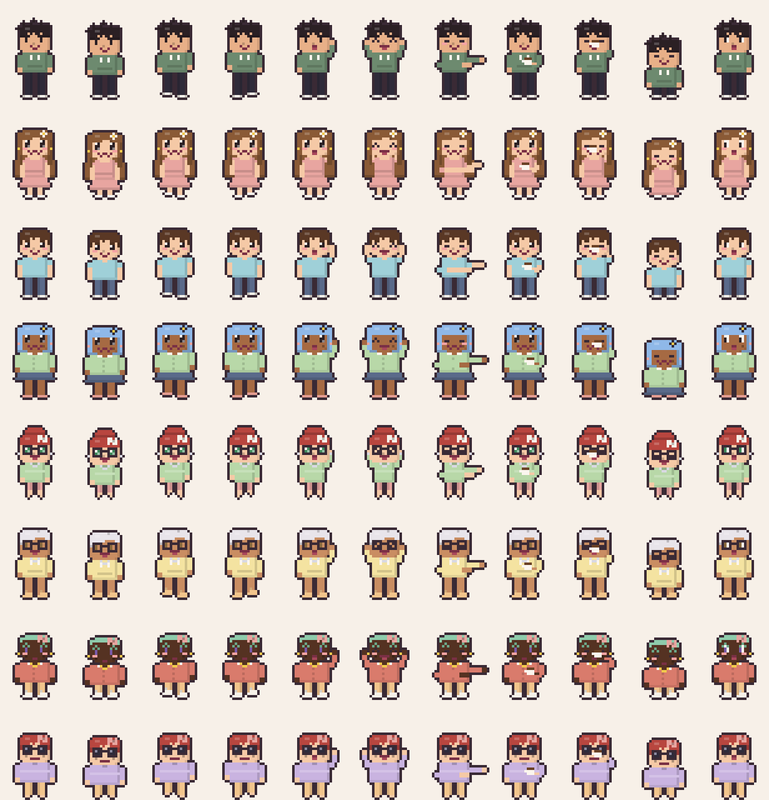
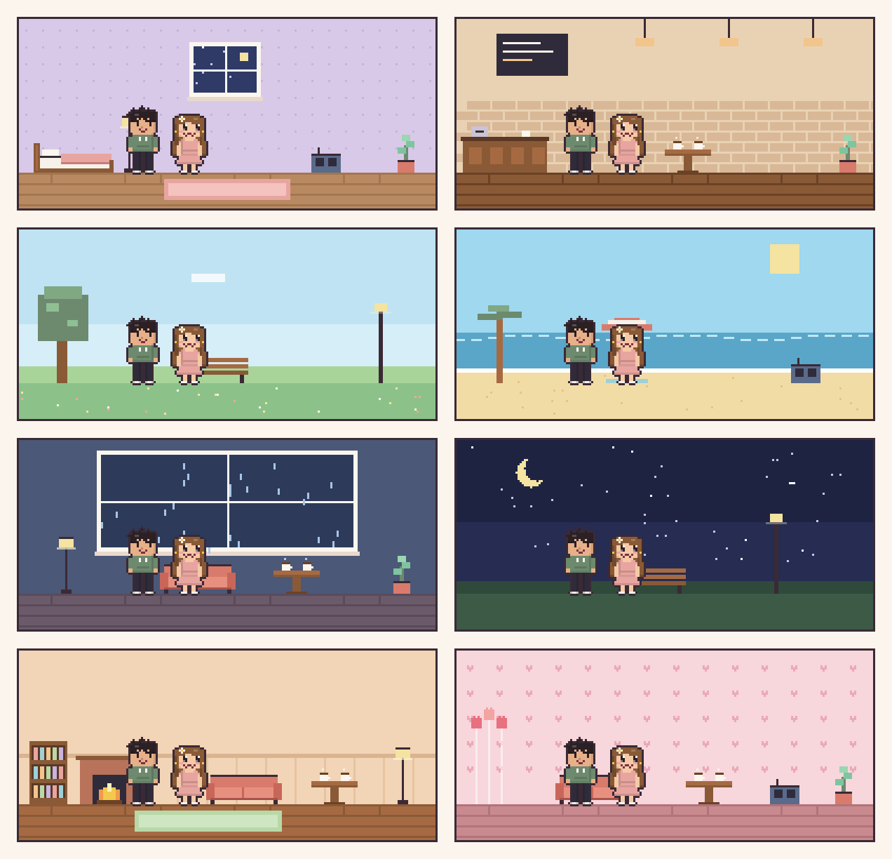

# Bello Together

**A little world for the two of you** — made by Bello.

Design yourself and your partner as pixel characters, then let them live on your desktop: they idle, wander, sit together, share coffee, hug, dance, play rock-paper-scissors, nap, and talk in little speech bubbles — while you keep working.



*Each row is a different character, each column a pose (idle, breathing, walking, waving, cheering, hugging, holding a cup, sipping, sitting, surprised). None of it is a static image: the art is generated from the character's parts, so every animation fits every design.*

## New — 🗣 English or Egyptian

Choose what they speak in their bubbles: **English** or **مصري** (Settings → *They speak*, or right-click → More… → 🗣). It covers everything they say: chats, the questions they ask you, games, mischief and fights. Your own lines stay as you wrote them; the rest of the app stays in English.

## New — 😤 Fight & make up

Every now and then, out of nowhere, one of them snaps (*«إنت كلت البطاطس بتاعتي؟!»*) and it's on — then they make up. Each fight is different:

- **Two or three rounds**, picked at random, always including one where they **throw things at each other from across the room**: slippers, pillows, tomatoes, books, the remote, a banana, a pie, a sock. Some hit (POW, splat, feathers), some get dodged and fly past and land on the floor, where they lie for a few seconds.
- The other rounds: **fists up** (punch, dodge, counter-punch), a **cartoon dust-cloud brawl** (fists, stars and cursing `#@$%!` come out of it, then they sit there dizzy), a **slipper chase** back and forth, a **pillow fight**.
- **Like an arcade fighting game**: health bars with their names at the top of the screen, *ROUND 1 … FIGHT!* before each round, the bars drop with every hit, some big hits land in slow motion with a white flash, and it ends in **K.O.!** (nobody wins). When they make up, their names light up in gold: **BELLO ♥ MALOUKA**.
- Malouka's signature move: her first throw is always the flying slipper 🩴.
- **The sulk**: backs turned, arms crossed, a storm cloud over each head. They both peek at the same moment… and snap back.
- **Making up**: one of them (the more affectionate one, usually) comes back, hesitates halfway, says sorry with a rose. The other stays cross for a while (*«هممف.»*), peeks, refuses again, and finally gives in.
- **The screen changes with them**: a red glow at the edges while they fight, grey while they sulk, and when they hug it turns warm pink-gold, and hearts and stars rise from above them.

It's rare and never starts when one of them is already sad. Start one yourself: right-click → **More… → 😤 Pick a fight (then make up)**. The fight lowers their mood a little; making up raises it a lot more.

**Bello and Malouka** are the app's own couple. Bello (white messy hair, light blue hoodie) is the starting look for your character, Malouka (twin tails, rose-red dress) for your partner. Pick either template and the character takes that name, and it can't be changed (the name field and right-click → Rename are locked). Pick any other base to name a character yourself.

## New — 😈 Mischief (opt-in, per character)

Switch it on for one of them (right-click → **Mischief**, or **Settings → Mischief**) and now and then they tease you:

- **Grab your mouse**: they sneak up on the cursor, grab it and run around the screen with it. Your clicks don't reach the desktop while they hold it — click them 2–4 times (more for playful ones) to get it back. Sometimes they stop to taunt you… and snatch it again. The partner notices: a kind one runs after them to scold, a playful one cheers them on.
- **Close your tab**: they climb up and wave *“Bye bye, tab!”* — click them within 2.5 s to stop it, or ⌘W / Ctrl+W closes the front tab (only when a browser is the front app; ⌘⇧T brings it back). macOS asks once for permission.
- Pace: rarely (~20 min), sometimes (~8 min), often (~3 min), or **Do it now!** from the menu.
- Safety: off by default; they never hold the mouse more than 12 s; pausing or hiding them (tray) ends any prank at once.

## New in v0.3 — scenes



Give them a little room on your desktop: bedroom, coffee shop, park, beach, rainy window, night sky, cozy room or Valentine's room. Rain falls, stars twinkle, the fire flickers. Click the furniture and they use it — nap on the bed, sit on the sofa, coffee at the table, dance by the radio, switch the lamp, water the plant. Drag the scene anywhere; drag any of its corners to make it bigger or smaller.

## New in v0.2 — play with them

- **Who's out**: both of them, or just one (Home, right-click, or the tray).
- **Mini games on your desktop**: ☕ *Coffee Catch* (catch falling coffee with your character), 💗 *Heart Pop* (pop the hearts they throw, not the gray ones), 🪞 *Copy Me* (repeat their dance), ✊ *Rock Paper Scissors* against you. High scores are kept. Esc stops.
- **They ask you things**: click them and sometimes a bubble pops up — *“Do you love me?” Yes / No*. They react, and a “yes” can start a coffee date or a game. Add your own questions on the Couple page.
- **Mood**: each one has feelings. Hurtful answers, being tossed around or ignored make them sad (sad face, a little rain cloud); games and kind answers cheer them up — and if one is sad, the other walks over to comfort them.
- **Rename them right on the desktop** (right-click → Rename).

## What works today (v0.1 — the MVP)

- **Create your character, then your partner** — two steps, each fully independent (the partner is never a copy).
- **Full creator**: face shape, skin, eyes (shape, size, colour), eyebrows, nose, mouth, blush/freckles/mole, 11 hair styles × 3 lengths × any colour, body shape, height, top/bottom/shoes with colours, hats, glasses, jewelry. Swatches plus a free colour picker for every colour.
- **Editor tools**: live animated preview in 9 poses, undo/redo (⌘Z / Ctrl+Z), randomize all or any single part, reset, pin a design to compare side by side, saved looks (presets), “save as version”, templates as optional starting points.
- **Identity & personality**: name, nickname (used in dialogue), optional pronouns, six personality sliders, dialogue tone, free-text traits, favourite activities and things. Personality changes *behaviour*: how often and how far they walk, walking speed, click reactions, who starts activities and which activities get picked.
- **The couple**: relationship dynamic (or your own words), “together since”, optional stage label, behaviour mode (stationary / relaxed / active / playful / couple), interaction frequency, which activities may start on their own, shared favourites, **your own dialogue lines** (with who says them first), built-in categories on/off.
- **Desktop world**: a transparent, borderless, always-on-top window over the work area. It is click-through everywhere except over the characters (and the menu), so your desktop keeps working.
  - Drag them anywhere; they react to being picked up and dropped (and the partner notices). Positions are remembered.
  - Click → a personality-weighted reaction. Double-click → quick menu. Right-click → full menu (activities, solo animations, edit, lock, pause, hide).
  - Hover → they look at the cursor and sometimes wave (can be turned off).
- **8 shared activities**, each a small state machine: ☕ coffee, 🤗 hug, 💃 dance, 🚶 walk together, 🪑 sit together, 😴 nap, ✊ rock-paper-scissors, 💬 talk — plus spontaneous moments (wave, glance, rare gift) and good-morning / good-night greetings.
- **Scheduler** weighs personalities, favourites, mode, cooldowns, history and time of day — never the same activity twice in a row.
- **Tray / menu-bar icon**: open, show, hide, pause/resume, start any activity, settings, quit. Closing the main window keeps the couple on the desktop.
- **Settings**: size (integer pixel scale, always crisp), bubble duration, mouse reactions, lock, pause, display picker (multi-monitor), low-performance mode, open at login, delete all data.
- **Library**: characters (duplicate, export/import as JSON, delete), animation library previewed on any character, multiple couples with a switch.
- **Private by default**: no account, no network, no analytics. Data is one SQLite file on your machine.

Not built yet (see [TASKS.md](TASKS.md)): imported PNG/GIF/sprite-sheet characters, optional AI dialogue, special dates (birthday/anniversary), custom global shortcuts.

## Run it

Requirements: Node 22+, pnpm, Rust (stable), and the [Tauri 2 prerequisites](https://v2.tauri.app/start/prerequisites/) for your OS (WebView2 on Windows is bundled with Windows 10/11).

```bash
pnpm install
pnpm app          # desktop app in dev mode (tauri dev)
pnpm bundle       # installers: .dmg/.app on macOS, .msi/.exe on Windows
pnpm test         # engine + domain tests (vitest)
pnpm typecheck
pnpm dev          # UI only, in a browser (no desktop world; data in localStorage, clearly bannered)
pnpm sheet        # re-render docs/sprites.png from the pixel composer
pnpm icons        # regenerate app + tray icons
```

## How it is built

Tauri 2 (Rust) + React 19 + TypeScript + Tailwind 4 + Zustand + SQLite (`tauri-plugin-sql`). Two windows: the **main app** and the **world** (transparent overlay). The world draws everything on one canvas with dirty-rect clearing and an adaptive clock (30 fps only while something moves, ~4–12 fps idle, ~0 when paused or hidden).

Read [docs/ARCHITECTURE.md](docs/ARCHITECTURE.md) for the full design, [DEVELOPMENT_PLAN.md](DEVELOPMENT_PLAN.md) for the phases and [TASKS.md](TASKS.md) for the checklist.

## Platform notes

- **macOS**: transparent windows use Tauri's `macos-private-api` (fine for direct distribution; not allowed on the Mac App Store). The world is visible on all Spaces. The tray icon is a template image, so it follows the menu-bar colour.
- **Windows**: the world window is skipped from the taskbar; click-through uses `WS_EX_TRANSPARENT` via `set_ignore_cursor_events`.
- Both: the characters live on the work area (above the taskbar / below the menu bar, beside the Dock).

## Share it with friends

Every version tag (`v0.2.0`, …) builds installers on GitHub (Windows + macOS) and publishes them on the repo's **Releases** page — send your friends that link.

- **Windows 10/11:** download the `.exe` setup and run it. SmartScreen may say “Windows protected your PC” because the app is not code-signed yet → **More info → Run anyway**.
- **macOS:** download the `.dmg`, drag *Bello Together* to Applications, then the first time **right-click it → Open → Open** (not notarized yet).

**Can't see them after installing?** The couple lives on your desktop work area (above the taskbar / below the menu bar), not in a normal window. Look for the Bello Together icon in the tray (Windows) or menu bar (macOS) and choose *Open* or *Show*. Closing the main window keeps them on the desktop, and right-clicking a character opens the full menu.

Everyone creates their own couple; nothing is shared between computers. To send someone *your* characters, use **My Characters → Export** and they **Import** the file.

To make a release: bump the version in `package.json`, `src-tauri/tauri.conf.json` and `src-tauri/Cargo.toml`, then `git tag v0.x.y && git push --tags`. A manual run of the **Build** workflow (Actions tab) builds without releasing and, on Windows, launches the app with a demo couple and uploads a screenshot.
